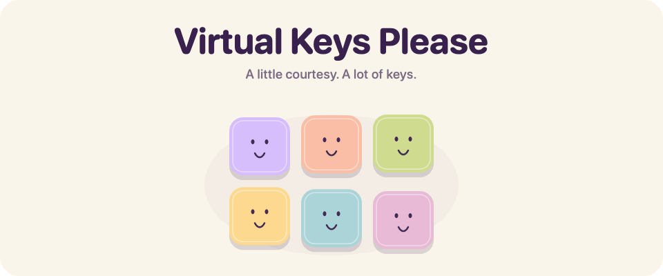
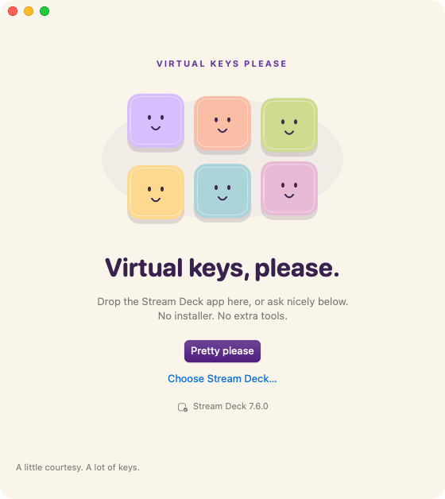

<p align="center">
  <picture>
    <source media="(prefers-color-scheme: dark) and (prefers-reduced-motion: reduce)" srcset=".github/assets/hero-dark.png">
    <source media="(prefers-reduced-motion: reduce)" srcset=".github/assets/hero-light.png">
    <source media="(prefers-color-scheme: dark)" srcset=".github/assets/hero-dark.gif">
    
  </picture>
</p>

<p align="center">
  A tiny Mac favor for Virtual Stream Deck.<br>
  Floating buttons, without keeping hardware connected.
</p>

<p align="center">
  <a href="https://github.com/austinpresley/virtual-keys-please/releases/latest/download/Virtual-Keys-Please.dmg">
    
  </a>
</p>

<p align="center">
  <strong>No installer. No Terminal. Just Pretty please.</strong><br>
  For Apple Silicon and Intel Macs running macOS 13 or later.<br>
  Version 1.0.1 is signed and notarized.
</p>

<p align="center">
  <a href="https://github.com/austinpresley/virtual-keys-please/releases/latest">Release notes</a>
  &nbsp; / &nbsp;
  <a href="https://github.com/austinpresley/virtual-keys-please/releases/latest/download/SHA256SUMS.txt">Checksums</a>
  &nbsp; / &nbsp;
  <a href="Sources">Browse the source</a>
</p>

## Say please

1. Open the disk image and run **Virtual Keys Please** right there.
2. Drop **Stream Deck.app** onto the window, or click **Pretty please**.
3. In Stream Deck's device menu, choose **Add Virtual Device**. Arrange your buttons.

The little keys do their happy dance. You can quit this utility and eject the disk image when you're done.

<details>
<summary><strong>Take a peek</strong></summary>
<br>
<p align="center">
  <picture>
    <source media="(prefers-color-scheme: dark)" srcset=".github/assets/app-dark.png">
    
  </picture>
</p>
</details>

## What the little favor changes

The app backs up one local activation setting and extends Virtual Stream Deck access through **January 1, 2100**. Stream Deck may briefly restart. Its signed app, plugins and button profiles stay intact.

There's no background service, account, telemetry or extra tool to install. Backups stay on your Mac. **Backups → Restore Last Change** puts the previous activation setting back, while protecting a newer independent change.

### A note about future versions

Verified with **Stream Deck 7.6.0** on Apple Silicon. The download contains both Mac architectures; Intel hardware and older macOS versions haven't been tested live.

The utility recognizes the activation method, rather than checking a version-number list. Future releases need the same constant, key derivation and record format. If Elgato changes the method, the utility needs an update. An Elgato update or a newly connected physical device can replace the activation record; run the utility again if needed.

<details>
<summary><strong>For the curious and the builders</strong></summary>

The [method notes](docs/METHOD.md) explain the local record format. The [verification notes](docs/VERIFICATION.md) cover tests and live checks.

Build locally with Xcode 26 or later and Swift 6.2 or later:

```sh
./build.sh
swift test --scratch-path "$HOME/Library/Developer/VirtualKeysPlease/build"
tools/selftest.sh
```

The universal app is written to `dist/`. Run `tools/snap.sh` for light/dark snapshots and layout checks. Run `swift tools/readme-art.swift .github/assets` to regenerate the smiling-key banners.

GitHub Actions stays disabled. Builds and tests run locally. Template attribution is in [Third-party notices](THIRD_PARTY_NOTICES.txt).

</details>

---

<p align="center">
  A little courtesy. A lot of keys.<br>
  <sub>An independent utility. Not affiliated with Elgato or Corsair.</sub>
</p>
